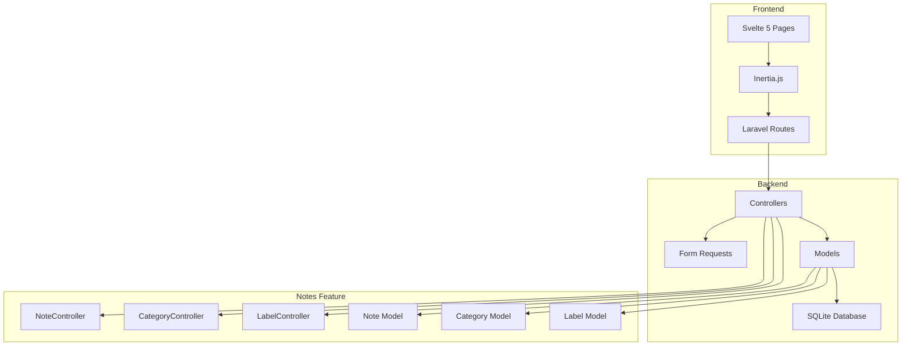

# Phase 2 — Core Notes: Rencana Implementasi Lengkap

## Ringkasan

Phase 2 mengimplementasikan fitur inti Noteds: CRUD catatan multi-tipe, kategori & label, pencarian cerdas, dan rich text editor. Semua fitur berada dalam scope **per-tim** — catatan dimiliki oleh tim, bukan user individu.

---

## Arsitektur Umum



---

## 1. Database Schema

### 1.1 Tabel `categories`

| Column | Type | Notes |
|--------|------|-------|
| id | bigint PK | auto-increment |
| team_id | foreignId | constrained, cascadeOnDelete |
| name | string | max 255 |
| color | string | hex color, default `#6366F1` |
| icon | string nullable | lucide icon name |
| created_at | timestamp | |
| updated_at | timestamp | |

**Index:** unique combo `team_id + name`

### 1.2 Tabel `labels`

| Column | Type | Notes |
|--------|------|-------|
| id | bigint PK | auto-increment |
| team_id | foreignId | constrained, cascadeOnDelete |
| name | string | max 255 |
| color | string | hex color, default `#8B5CF6` |
| created_at | timestamp | |
| updated_at | timestamp | |

**Index:** unique combo `team_id + name`

### 1.3 Tabel `notes`

| Column | Type | Notes |
|--------|------|-------|
| id | bigint PK | auto-increment |
| team_id | foreignId | constrained, cascadeOnDelete |
| user_id | foreignId | constrained, cascadeOnDelete — author |
| title | string | max 255 |
| content | json | konten fleksibel berdasarkan tipe |
| excerpt | text | ringkasan otomatis max 300 char |
| type | string | enum: text, checklist, list, code |
| is_pinned | boolean | default false |
| is_archived | boolean | default false |
| category_id | foreignId nullable | constrained, setNullOnDelete |
| created_at | timestamp | |
| updated_at | timestamp | |
| deleted_at | timestamp nullable | soft deletes |

**Indexes:**
- `team_id + is_pinned + updated_at` (query utama)
- `team_id + category_id` (filter kategori)
- `user_id` (filter author)

### 1.4 Tabel Pivot `label_note`

| Column | Type | Notes |
|--------|------|-------|
| label_id | foreignId | constrained, cascadeOnDelete |
| note_id | foreignId | constrained, cascadeOnDelete |

**Primary key:** composite `label_id + note_id`

### 1.5 Full-Text Search (FTS5)

Untuk pencarian cerdas, gunakan **SQLite FTS5** virtual table:

```sql
CREATE VIRTUAL TABLE notes_fts USING fts5(
    title,
    content,
    content='notes',
    content_rowid='id'
);
```

Trigger otomatis sync saat INSERT/UPDATE/DELETE pada tabel `notes`.

---

## 2. Enum & Constants

### 2.1 `App\Enums\NoteType`

```php
enum NoteType: string
{
    case Text = 'text';
    case Checklist = 'checklist';
    case List = 'list';
    case Code = 'code';

    public function label(): string { /* ... */ }
    public function icon(): string { /* lucide icon name */ }
}
```

### 2.2 `App\Enums\NoteContent` — Struktur JSON per tipe

| Tipe | Struktur `content` JSON |
|------|------------------------|
| text | `{ "html": "...", "text": "..." }` |
| checklist | `{ "items": [{ "text": "...", "checked": bool }] }` |
| list | `{ "items": ["item 1", "item 2"] }` |
| code | `{ "code": "...", "language": "javascript" }` |

---

## 3. Models

### 3.1 `App\Models\Note`

```php
class Note extends Model implements HasFactory, SoftDeletes
{
    // Fillable: title, content, type, is_pinned, is_archived, category_id, team_id, user_id

    // Casts: content -> array, is_pinned -> boolean, is_archived -> boolean, type -> NoteType::class

    // Relationships:
    public function team(): BelongsTo
    public function author(): BelongsTo  // user_id -> User
    public function category(): BelongsTo
    public function labels(): BelongsToMany

    // Scopes:
    public function scopeForTeam($query, Team $team)
    public function scopePinned($query)
    public function scopeNotArchived($query)
    public function scopeInCategory($query, int $categoryId)
    public function scopeWithLabel($query, int $labelId)
    public function scopeSearch($query, string $term) // FTS5
    public function scopeOfType($query, NoteType $type)

    // Methods:
    public function generateExcerpt(): void  // auto-generate from content
}
```

### 3.2 `App\Models\Category`

```php
class Category extends Model implements HasFactory
{
    // Fillable: name, color, icon, team_id

    // Relationships:
    public function team(): BelongsTo
    public function notes(): HasMany

    // Constraints: unique name per team
}
```

### 3.3 `App\Models\Label`

```php
class Label extends Model implements HasFactory
{
    // Fillable: name, color, team_id

    // Relationships:
    public function team(): BelongsTo
    public function notes(): BelongsToMany

    // Constraints: unique name per team
}
```

### 3.4 Update `App\Models\Team`

Tambahkan relationships:

```php
// Tambahkan ke Team.php:
public function notes(): HasMany
public function categories(): HasMany
public function labels(): HasMany
```

### 3.5 Update `App\Models\User`

Tambahkan relationship:

```php
// Tambahkan ke User.php:
public function notes(): HasMany  // notes yang ditulis oleh user
```

---

## 4. Routes

### 4.1 Catatan — `routes/notes.php`

Semua route berada dalam scope `{current_team}` dengan middleware `auth`, `verified`, `EnsureTeamMembership`.

| Method | URI | Controller | Name | Description |
|--------|-----|-----------|------|-------------|
| GET | `/{current_team}/notes` | NoteController@index | `notes.index` | List catatan |
| GET | `/{current_team}/notes/create` | NoteController@create | `notes.create` | Form buat catatan |
| POST | `/{current_team}/notes` | NoteController@store | `notes.store` | Simpan catatan baru |
| GET | `/{current_team}/notes/{note}` | NoteController@show | `notes.show` | Detail catatan |
| GET | `/{current_team}/notes/{note}/edit` | NoteController@edit | `notes.edit` | Form edit catatan |
| PUT | `/{current_team}/notes/{note}` | NoteController@update | `notes.update` | Update catatan |
| DELETE | `/{current_team}/notes/{note}` | NoteController@destroy | `notes.destroy` | Hapus catatan |
| PATCH | `/{current_team}/notes/{note}/pin` | NoteController@togglePin | `notes.pin` | Toggle pin |
| PATCH | `/{current_team}/notes/{note}/archive` | NoteController@toggleArchive | `notes.archive` | Toggle archive |

### 4.2 Kategori — `routes/categories.php`

| Method | URI | Controller | Name |
|--------|-----|-----------|------|
| GET | `/{current_team}/categories` | CategoryController@index | `categories.index` |
| POST | `/{current_team}/categories` | CategoryController@store | `categories.store` |
| PUT | `/{current_team}/categories/{category}` | CategoryController@update | `categories.update` |
| DELETE | `/{current_team}/categories/{category}` | CategoryController@destroy | `categories.destroy` |

### 4.3 Label — `routes/labels.php`

| Method | URI | Controller | Name |
|--------|-----|-----------|------|
| GET | `/{current_team}/labels` | LabelController@index | `labels.index` |
| POST | `/{current_team}/labels` | LabelController@store | `labels.store` |
| PUT | `/{current_team}/labels/{label}` | LabelController@update | `labels.update` |
| DELETE | `/{current_team}/labels/{label}` | LabelController@destroy | `labels.destroy` |

### 4.4 Pencarian — `routes/search.php`

| Method | URI | Controller | Name |
|--------|-----|-----------|------|
| GET | `/{current_team}/search` | SearchController@index | `search.index` |

**Query params:** `?q=keyword&type=text&category_id=1&label_id=2`

---

## 5. Controllers

### 5.1 `App\Http\Controllers\Notes\NoteController`

```php
class NoteController extends Controller
{
    // index: List catatan dengan filter (type, category, label, search, archived, pinned)
    //   - Paginate 20 items
    //   - Eager load: category, labels, author
    //   - Default sort: pinned first, then by updated_at desc
    //   - Search via FTS5 if `q` param exists
    //   - Render: 'notes/Index'

    // create: Form buat catatan baru
    //   - Pass: categories, labels for current team
    //   - Render: 'notes/Create'

    // store: Simpan catatan baru
    //   - Validate via StoreNoteRequest
    //   - Auto-generate excerpt
    //   - Sync labels
    //   - Redirect ke notes.index dengan toast

    // show: Detail catatan
    //   - Eager load: category, labels, author
    //   - Render: 'notes/Show'

    // edit: Form edit catatan
    //   - Pass: note, categories, labels
    //   - Render: 'notes/Edit'

    // update: Update catatan
    //   - Validate via UpdateNoteRequest
    //   - Auto-regenerate excerpt
    //   - Sync labels
    //   - Redirect ke notes.show dengan toast

    // destroy: Hapus catatan (soft delete)
    //   - Redirect ke notes.index dengan toast

    // togglePin: Toggle status pin
    //   - Return back dengan toast

    // toggleArchive: Toggle status archive
    //   - Return back dengan toast
}
```

### 5.2 `App\Http\Controllers\Notes\CategoryController`

CRUD sederhana untuk kategori. Saat hapus kategori, `category_id` pada catatan terkait menjadi `null`.

### 5.3 `App\Http\Controllers\Notes\LabelController`

CRUD sederhana untuk label. Label menggunakan pivot table, sehingga saat hapus label, relasi pada catatan otomatis terhapus.

### 5.4 `App\Http\Controllers\Notes\SearchController`

```php
class SearchController extends Controller
{
    // index: Pencarian full-text via FTS5
    //   - Query param: q, type, category_id, label_id
    //   - Return: notes yang match, grouped by relevance
    //   - Render: 'notes/Search'
}
```

---

## 6. Form Requests

### 6.1 `App\Http\Requests\Notes\StoreNoteRequest`

```php
class StoreNoteRequest extends FormRequest
{
    // Rules:
    //   title: required|string|max:255
    //   content: required|array
    //   type: required|in:text,checklist,list,code
    //   category_id: nullable|exists:categories,id
    //   label_ids: nullable|array
    //   label_ids.*: exists:labels,id
}
```

### 6.2 `App\Http\Requests\Notes\UpdateNoteRequest`

Sama seperti StoreNoteRequest, semua field optional (partial update).

### 6.3 `App\Http\Requests\Notes\StoreCategoryRequest`

```php
// Rules:
//   name: required|string|max:255
//   color: required|string|max:7
//   icon: nullable|string|max:50
```

### 6.4 `App\Http\Requests\Notes\StoreLabelRequest`

```php
// Rules:
//   name: required|string|max:255
//   color: required|string|max:7
```

---

## 7. Policies

### 7.1 `App\Policies\NotePolicy`

```php
class NotePolicy
{
    // viewAny: Semua member tim bisa lihat
    // view: Semua member tim bisa lihat
    // create: Semua member tim bisa buat
    // update: Hanya author atau admin/owner
    // delete: Hanya author atau admin/owner
}
```

### 7.2 `App\Policies\CategoryPolicy`

```php
class CategoryPolicy
{
    // Semua CRUD: Semua member tim (karena ini tim-scoped)
}
```

---

## 8. Frontend (Svelte 5 + Inertia.js)

### 8.1 Pages

| File | Description |
|------|-------------|
| `resources/js/pages/notes/Index.svelte` | List catatan — grid/list view, filter sidebar, search bar |
| `resources/js/pages/notes/Create.svelte` | Form buat catatan baru — pilih tipe, editor |
| `resources/js/pages/notes/Show.svelte` | Detail catatan — baca + aksi (pin, archive, edit, hapus) |
| `resources/js/pages/notes/Edit.svelte` | Form edit catatan |
| `resources/js/pages/notes/Search.svelte` | Hasil pencarian |
| `resources/js/pages/notes/components/NotesGrid.svelte` | Grid view catatan |
| `resources/js/pages/notes/components/NotesList.svelte` | List view catatan |
| `resources/js/pages/notes/components/NoteCard.svelte` | Kartu catatan untuk grid |
| `resources/js/pages/notes/components/NoteTypeSelector.svelte` | Pilih tipe catatan |
| `resources/js/pages/notes/components/FilterSidebar.svelte` | Sidebar filter (kategori, label, tipe) |
| `resources/js/pages/notes/components/CategoryManager.svelte` | CRUD kategori (modal/drawer) |
| `resources/js/pages/notes/components/LabelManager.svelte` | CRUD label (modal/drawer) |
| `resources/js/pages/categories/Index.svelte` | Halaman manajemen kategori |
| `resources/js/pages/labels/Index.svelte` | Halaman manajemen label |

### 8.2 Rich Text Editor — TipTap

**Package:** `@tiptap/svelte-5`, `@tiptap/starter-kit`, `@tiptap/extension-*`

Komponen editor yang dibuat:

| File | Description |
|------|-------------|
| `resources/js/components/editor/RichTextEditor.svelte` | Wrapper utama TipTap editor |
| `resources/js/components/editor/EditorToolbar.svelte` | Toolbar bold, italic, heading, list, code, dll |
| `resources/js/components/editor/ChecklistEditor.svelte` | Editor khusus tipe checklist |
| `resources/js/components/editor/ListEditor.svelte` | Editor khusus tipe list |
| `resources/js/components/editor/CodeEditor.svelte` | Editor khusus tipe code (dengan syntax highlighting) |

**TipTap Extensions yang digunakan:**
- `@tiptap/starter-kit` (paragraph, heading, bold, italic, strike, code, blockquote, bullet list, ordered list, code block, hard break, horizontal rule, history)
- `@tiptap/extension-placeholder` (placeholder text)
- `@tiptap/extension-task-list` + `@tiptap/extension-task-item` (checklist)
- `@tiptap/extension-highlight` (highlight teks)
- `@tiptap/extension-code-block-lowlight` (syntax highlighting) — optional, bisa ditambah later

### 8.3 Sidebar Navigation Update

Update `AppSidebar.svelte` untuk menambahkan menu Notes:

```typescript
const mainNavItems = $derived<NavItem[]>([
    {
        title: 'Dashboard',
        href: dashboardUrl,
        icon: LayoutGrid,
    },
    {
        title: 'Catatan',
        href: notesUrl,  ///{current_team}/notes
        icon: FileText,  // lucide-svelte
    },
]);
```

### 8.4 TypeScript Types — `resources/js/types/notes.ts`

```typescript
export type NoteType = 'text' | 'checklist' | 'list' | 'code';

export type NoteContent = {
    text?: { html: string; text: string };
    checklist?: { items: { text: string; checked: boolean }[] };
    list?: { items: string[] };
    code?: { code: string; language: string };
};

export type Note = {
    id: number;
    title: string;
    content: NoteContent;
    excerpt: string;
    type: NoteType;
    isPinned: boolean;
    isArchived: boolean;
    category: Category | null;
    labels: Label[];
    author: { id: number; name: string; email: string };
    createdAt: string;
    updatedAt: string;
};

export type Category = {
    id: number;
    name: string;
    color: string;
    icon: string | null;
    notesCount: number;
};

export type Label = {
    id: number;
    name: string;
    color: string;
    notesCount: number;
};
```

---

## 9. Wayfinder Routes

Setelah menambah routes di Laravel, jalankan `php artisan wayfinder:generate` untuk auto-generate TypeScript route definitions di `resources/js/actions/`. Ini akan menghasilkan file seperti:

- `resources/js/actions/App/Http/Controllers/Notes/NoteController.ts`
- `resources/js/actions/App/Http/Controllers/Notes/CategoryController.ts`
- `resources/js/actions/App/Http/Controllers/Notes/LabelController.ts`
- `resources/js/actions/App/Http/Controllers/Notes/SearchController.ts`

---

## 10. Seeders & Factories

### 10.1 `NoteFactory`

```php
// Generate catatan sample dengan berbagai tipe
// Konten JSON realistis per tipe
```

### 10.2 `CategoryFactory`

```php
// Kategori sample: Pekerjaan, Pribadi, Keuangan, Proyek, dll
// Warna berbeda per kategori
```

### 10.3 `LabelFactory`

```php
// Label sample: Penting, Draft, Review, Selesai, dll
// Warna berbeda per label
```

### 10.4 Update `DatabaseSeeder`

```php
// Seed 1 team personal dengan:
// - 5 kategori
// - 8 label
// - 20 catatan (berbagai tipe)
```

---

## 11. File Structure (Backend)

```
app/
├── Enums/
│   └── NoteType.php                          # NEW
├── Http/
│   ├── Controllers/
│   │   └── Notes/
│   │       ├── NoteController.php             # NEW
│   │       ├── CategoryController.php         # NEW
│   │       ├── LabelController.php            # NEW
│   │       └── SearchController.php           # NEW
│   └── Requests/
│       └── Notes/
│           ├── StoreNoteRequest.php           # NEW
│           ├── UpdateNoteRequest.php          # NEW
│           ├── StoreCategoryRequest.php       # NEW
│           ├── StoreLabelRequest.php          # NEW
├── Models/
│   ├── Note.php                               # NEW
│   ├── Category.php                           # NEW
│   ├── Label.php                              # NEW
│   ├── Team.php                               # UPDATE — tambah notes, categories, labels relationships
│   └── User.php                               # UPDATE — tambah notes relationship
└── Policies/
    ├── NotePolicy.php                         # NEW
    ├── CategoryPolicy.php                     # NEW
    └── LabelPolicy.php                        # NEW
```

## 12. File Structure (Frontend)

```
resources/js/
├── components/
│   └── editor/
│       ├── RichTextEditor.svelte              # NEW
│       ├── EditorToolbar.svelte               # NEW
│       ├── ChecklistEditor.svelte             # NEW
│       ├── ListEditor.svelte                  # NEW
│       └── CodeEditor.svelte                  # NEW
├── pages/
│   ├── notes/
│   │   ├── Index.svelte                       # NEW
│   │   ├── Create.svelte                      # NEW
│   │   ├── Show.svelte                        # NEW
│   │   ├── Edit.svelte                        # NEW
│   │   ├── Search.svelte                      # NEW
│   │   └── components/
│   │       ├── NotesGrid.svelte               # NEW
│   │       ├── NotesList.svelte               # NEW
│   │       ├── NoteCard.svelte                # NEW
│   │       ├── NoteTypeSelector.svelte        # NEW
│   │       ├── FilterSidebar.svelte           # NEW
│   │       ├── CategoryManager.svelte         # NEW
│   │       └── LabelManager.svelte            # NEW
│   └── categories/
│       └── Index.svelte                       # NEW
├── types/
│   └── notes.ts                               # NEW
└── components/
    └── AppSidebar.svelte                      # UPDATE — tambah menu Catatan
```

## 13. File Structure (Database)

```
database/
├── migrations/
│   └── 2026_07_15_000001_create_notes_tables.php   # NEW
├── factories/
│   ├── NoteFactory.php                             # NEW
│   ├── CategoryFactory.php                         # NEW
│   └── LabelFactory.php                            # NEW
└── seeders/
    └── DatabaseSeeder.php                          # UPDATE — tambah seed data
```

---

## 14. Urutan Implementasi (Todo List)

### Step 1: Database & Models
1. Buat migration `create_notes_tables.php` (notes, categories, labels, label_note, notes_fts)
2. Buat enum `NoteType.php`
3. Buat model `Category.php`
4. Buat model `Label.php`
5. Buat model `Note.php`
6. Update model `Team.php` — tambah relationships
7. Update model `User.php` — tambah relationship `notes()`
8. Jalankan migration

### Step 2: Backend — Kategori & Label
9. Buat `StoreCategoryRequest.php`
10. Buat `StoreLabelRequest.php`
11. Buat `CategoryController.php` (CRUD)
12. Buat `LabelController.php` (CRUD)
13. Buat routes `categories.php` dan `labels.php`
14. Daftarkan routes di `web.php`

### Step 3: Backend — Catatan
15. Buat `StoreNoteRequest.php`
16. Buat `UpdateNoteRequest.php`
17. Buat `NoteController.php` (CRUD + pin/archive + search)
18. Buat `SearchController.php`
19. Buat routes `notes.php` dan `search.php`
20. Daftarkan routes di `web.php`
21. Buat `NotePolicy.php`, `CategoryPolicy.php`, `LabelPolicy.php`

### Step 4: Rich Text Editor
22. Install TipTap packages (`@tiptap/svelte-5`, extensions)
23. Buat `RichTextEditor.svelte`
24. Buat `EditorToolbar.svelte`
25. Buat `ChecklistEditor.svelte`
26. Buat `ListEditor.svelte`
27. Buat `CodeEditor.svelte`

### Step 5: Frontend — Kategori & Label Pages
28. Buat `categories/Index.svelte`
29. Buat `labels/Index.svelte`

### Step 6: Frontend — Notes Pages
30. Buat TypeScript types `notes.ts`
31. Buat `NoteCard.svelte`
32. Buat `NotesGrid.svelte`
33. Buat `NotesList.svelte`
34. Buat `NoteTypeSelector.svelte`
35. Buat `FilterSidebar.svelte`
36. Buat `CategoryManager.svelte`
37. Buat `LabelManager.svelte`
38. Buat `notes/Index.svelte` (list page dengan filter & search)
39. Buat `notes/Create.svelte` (form buat catatan)
40. Buat `notes/Show.svelte` (detail catatan)
41. Buat `notes/Edit.svelte` (form edit catatan)
42. Buat `notes/Search.svelte` (hasil pencarian)

### Step 7: Integrasi Sidebar & Wayfinder
43. Update `AppSidebar.svelte` — tambah menu Catatan
44. Jalankan `php artisan wayfinder:generate`

### Step 8: Seeders & Factories
45. Buat `CategoryFactory.php`
46. Buat `LabelFactory.php`
47. Buat `NoteFactory.php`
48. Update `DatabaseSeeder.php`

### Step 9: Testing & Polish
49. Jalankan migration & seed
50. Test semua CRUD operations
51. Test search functionality
52. Test filter by category/label/type
53. Test pin/archive toggle
54. Test rich text editor semua tipe
55. Update `README.md` — tandai Phase 2 selesai

---

## 15. Pertimbangan Teknis

### Full-Text Search (FTS5)
- SQLite FTS5 sangat cepat untuk dataset menengah
- Trigger otomatis menjaga sync antara `notes` dan `notes_fts`
- Ranking menggunakan `bm25()` function bawaan FTS5
- Fallback ke `LIKE '%term%'` jika FTS5 tidak tersedia

### Content JSON Flexibilitas
- Setiap tipe catatan memiliki struktur JSON berbeda
- Frontend merender editor yang sesuai berdasarkan `type`
- Backend tidak perlu validasi konten secara ketat — biarkan frontend handle

### Soft Deletes
- Catatan dihapus secara soft delete (ada `deleted_at`)
- User bisa "restore" catatan yang terhapus (opsional, bisa ditambah later)
- Arsitektur memungkinkan fitur "Trash" di Phase 5

### Team Scoping
- Semua query notes, categories, labels di-scoping berdasarkan `team_id`
- Policy memastikan user hanya bisa akses data tim mereka
- `EnsureTeamMembership` middleware sudah ada dan akan digunakan

### Performance
- Eager loading untuk relationships (category, labels, author) mencegah N+1
- Pagination 20 items per halaman
- FTS5 untuk pencarian cepat
- Index pada kolom yang sering di-query

---

## 16. Dependencies Baru

### PHP (composer.json)
Tidak perlu package baru — Laravel sudah punya semua yang dibutuhkan.

### JavaScript (package.json)
```json
{
    "@tiptap/svelte-5": "^3.0.0",
    "@tiptap/starter-kit": "^3.0.0",
    "@tiptap/extension-placeholder": "^3.0.0",
    "@tiptap/extension-task-list": "^3.0.0",
    "@tiptap/extension-task-item": "^3.0.0",
    "@tiptap/extension-highlight": "^3.0.0"
}
```
